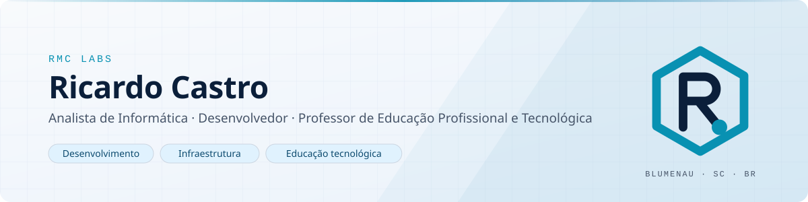

<picture>
  <source media="(prefers-color-scheme: dark)" srcset="assets/banner-dark.svg">
  <source media="(prefers-color-scheme: light)" srcset="assets/banner-light.svg">
  
</picture>

# Olá, sou Ricardo Castro.

**Construo e mantenho sistemas, cuido da infraestrutura que os sustenta e formo quem vai fazer o mesmo.**
Analista de Informática, desenvolvedor e professor de Educação Profissional e Tecnológica, em Blumenau (SC).

  <a href="https://www.ricardormcastro.com.br/">ricardormcastro.com.br</a>&nbsp;&nbsp;·&nbsp;&nbsp;
  <a href="mailto:contato@ricardormcastro.com.br">contato@ricardormcastro.com.br</a>&nbsp;&nbsp;·&nbsp;&nbsp;
  <a href="https://github.com/rrmcastro">github.com/rrmcastro</a>

 

## Sobre mim

Sou bacharel em Sistemas de Informação pela FURB e pós-graduado em Docência para a Educação Profissional e Tecnológica e em Desenvolvimento de Sistemas com Python. Atuo como Analista de Informática em uma autarquia municipal, onde desenvolvo e evoluo aplicações web, modernizo sistemas legados, administro servidores Linux e Windows e cuido de bancos de dados, integrações e automação de processos.

Em paralelo, leciono programação e sistemas de informação no ensino técnico e já orientei curso técnico em Desenvolvimento de Sistemas. Essa combinação me dá uma visão prática do ciclo completo: entender o problema, construir a solução, colocá-la em produção e explicar como ela funciona.

Sob a marca **RMC Labs**, desenvolvo projetos independentes e atendo pequenos negócios com sites, automações e melhorias em sistemas existentes.

 

## O que eu faço

<table>
  <tr>
    <td width="33%" valign="top">
      <h3>Desenvolvimento de Software</h3>
      Construção, manutenção e evolução de aplicações web e sistemas de gestão, com foco em código sustentável e no problema que precisa ser resolvido.
    </td>
    <td width="33%" valign="top">
      <h3>Infraestrutura e Sistemas</h3>
      Administração de servidores, bancos de dados, redes e serviços; integração entre sistemas e modernização de soluções legadas.
    </td>
    <td width="33%" valign="top">
      <h3>Educação e Conhecimento</h3>
      Formação técnica em programação e sistemas, orientação de laboratórios e documentação que ajuda outras pessoas a entender e manter o que foi feito.
    </td>
  </tr>
</table>

 

## Competências

**Hard skills**

`Desenvolvimento web` `Sistemas de gestão` `Modernização de sistemas legados` `Modelagem de bancos de dados` `Integração de sistemas` `Automação de processos` `Administração de servidores Linux e Windows` `Redes e virtualização` `Gestão de serviços de TI` `Documentação técnica`

**Soft skills**

`Didática` `Comunicação técnica` `Resolução de problemas` `Visão do ciclo completo` `Orientação e mentoria` `Atendimento ao cliente` `Autonomia` `Aprendizado contínuo`

 

## Tecnologias

As tecnologias abaixo estão separadas conforme o uso real: o que aplico em projetos e no trabalho, o que estou adotando em projetos em andamento e o que explorei em estudos.

| Área | Em uso | Em adoção | Em estudo |
| :-- | :-- | :-- | :-- |
| **Linguagens** | PHP · JavaScript · SQL · HTML5 · CSS3 · Python · Java | | |
| **Frameworks e bibliotecas** | | Laravel · Livewire · Tailwind CSS | Spring Boot · Django · Vue.js · Flutter · React |
| **Bancos de dados** | MySQL · MariaDB | | PostgreSQL |
| **Infraestrutura** | Linux / Ubuntu Server · Windows Server · Apache · SSH · Virtualização · Redes | GitHub Actions | Zabbix |
| **Ferramentas** | Git / GitHub · VS Code · GLPI · TrueNAS | | |

 

## Projetos em destaque

### RMC Labs — Portal profissional
Site institucional que reúne portfólio, serviços e canal de contato para pequenos negócios: sites, automação de processos e manutenção de aplicações web, principalmente em PHP com bancos relacionais.

**Status:** publicado · [ricardormcastro.com.br](https://www.ricardormcastro.com.br/)

### Plataforma SaaS para atendimento veterinário domiciliar
Aplicação web para médicos-veterinários que atendem em domicílio ou de forma volante: agenda, pacientes e tutores, prontuários, prescrições em PDF, controle financeiro e de insumos, em modelo multiempresa por assinatura.

**Stack planejada:** PHP · Laravel · Livewire · Tailwind CSS · MySQL · **Status:** em desenvolvimento (repositório privado)

### Memória Familiar Colaborativa
Aplicação web para preservar e organizar histórias de família: linha do tempo por pessoa, compartilhamento de fotografias com identificação de pessoas, eventos e grupos familiares distintos, aproveitando metadados EXIF (data e local) quando disponíveis.

**Status:** projeto independente em desenvolvimento (repositório privado)

### Gestão de laboratórios de informática
Ferramentas para ambientes de informática educacionais: inventário de equipamentos, acompanhamento de manutenção, registro de ocorrências, chamados, painéis e base de conhecimento. Experiência de prototipação e desenvolvimento nascida da rotina em laboratórios de ensino técnico.

**Status:** protótipos e ferramentas internas (repositórios privados)

 

## Estudos e laboratórios

Repositórios públicos de cursos, workshops e experimentos. São materiais de aprendizado que acompanham cursos de terceiros, não projetos autorais completos.

| Repositório | O que explora | Tecnologias |
| :-- | :-- | :-- |
| [course-springboot-2-java11](https://github.com/rrmcastro/course-springboot-2-java11) | API REST em camadas com JPA, perfis de ambiente e banco H2/PostgreSQL | Java · Spring Boot · Maven |
| [workshop-javafx-jdbc](https://github.com/rrmcastro/workshop-javafx-jdbc) | Aplicação desktop com padrão DAO e persistência em MySQL | Java · JavaFX · JDBC |
| [django_blog](https://github.com/rrmcastro/django_blog) | Aplicação web responsiva com autenticação, editor rico e módulos de curso e quiz | Python · Django 4 · Bootstrap 5 |
| [alura_space](https://github.com/rrmcastro/alura_space) | Galeria de imagens com templates, arquivos estáticos e variáveis de ambiente | Python · Django |
| [flutter_com_webapi](https://github.com/rrmcastro/flutter_com_webapi) | App mobile consumindo Web API com HTTP, interceptors e async/await | Dart · Flutter |
| [vuetify-todo](https://github.com/rrmcastro/vuetify-todo) | Lista de tarefas com Vuex, Vue Router e Material Design | Vue.js 2 · Vuetify |
| [Raspberry-Pi-Interruptions](https://github.com/rrmcastro/Raspberry-Pi-Interruptions) | Polling versus interrupções em GPIO, com callbacks em thread | Python · RPi.GPIO |

 

## Contato

Para projetos, colaborações ou uma conversa sobre tecnologia e educação:

- **Site e orçamentos:** [ricardormcastro.com.br](https://www.ricardormcastro.com.br/)
- **E-mail:** [contato@ricardormcastro.com.br](mailto:contato@ricardormcastro.com.br)
- **GitHub:** [@rrmcastro](https://github.com/rrmcastro)

 

  <picture>
    <source media="(prefers-color-scheme: dark)" srcset="assets/logo-dark.svg">
    <source media="(prefers-color-scheme: light)" srcset="assets/logo-light.svg">
    
  </picture>
   
  Ricardo R. M. Castro · RMC Labs · Blumenau, SC

